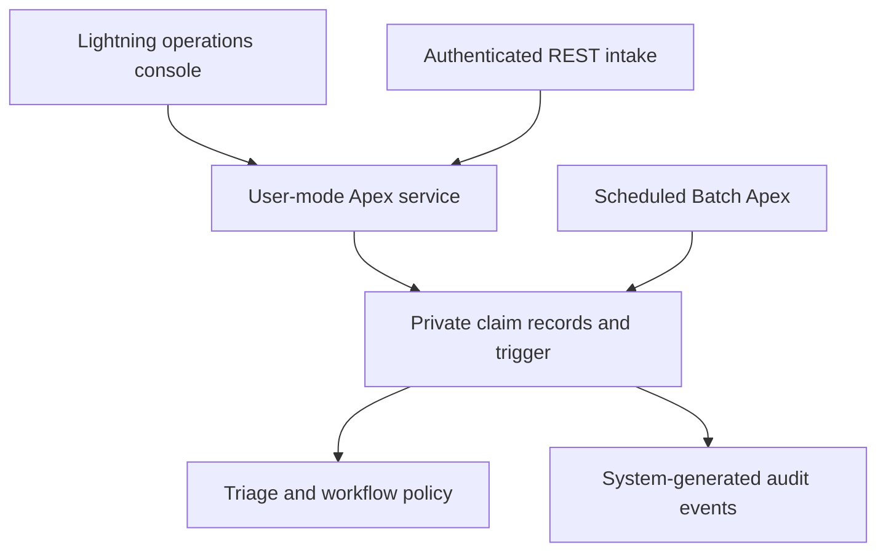

# ClaimGuard

**Salesforce Apex for traceable banking dispute operations.**

A portfolio application for Denzel Leonardo Rose Acosta. ClaimGuard accepts a disputed transaction, assigns a deterministic priority and deadline, moves it through an investigation workflow, and preserves an append-only application audit trail.

**Build status:** local Apex grammar checks, LWC compilation and metadata structure checks pass. **30 Apex test methods are authored; Salesforce execution, code coverage and deployment validation are pending.** This repository is a development project, not a production banking deployment.

## The problem

When a dispute arrives more than once, an operations team can investigate the same transaction twice. When deadlines and decisions live in separate spreadsheets, urgent claims can be overlooked and the reason for a decision becomes harder to reconstruct.

ClaimGuard brings intake, investigation and accountability into one Salesforce application. It uses synthetic references and a fictional bank; it has no affiliation with Banco Nacional or another financial institution.

## What makes this more than CRUD

| Capability | Implementation | Why it matters |
| --- | --- | --- |
| Safe retry | Case-insensitive unique external key, payload comparison and replay response | A retried request returns the original visible claim instead of creating another |
| Consistent triage | Pure Apex policy; category and currency-specific amount thresholds | Decisions are explainable and have repeatable boundary tests |
| Controlled workflow | New → InReview → Resolved / Rejected; closure requires a reason | A claim cannot skip investigation or silently change its original intake data |
| Concurrent updates | Row lock plus expected-status check | A stale console cannot overwrite a later decision |
| Bulk processing | Collection-based trigger and one audit insert per trigger execution | The 200-record test asserts constant database statement usage |
| Automated escalation | Scheduled Batch Apex, locked recheck, idempotent flag | An expired, open claim is flagged once even when a batch scope is stale |
| Access controls | Private claims, inherited audit access, explicit user-mode API operations, agent and viewer permission sets | Object, field and record access are part of the design |
| Explainable decisions | System-generated audit records, read-only for application users | Status changes and escalations can be reconstructed without logging sensitive request bodies |

## Architecture



The trigger applies invariants to all record entry paths, including the native Salesforce form. REST adds idempotent replay and strict input validation. The audit writer and escalation job are the two narrowly scoped, intentional system-mode boundaries. See [architecture decisions](docs/ARCHITECTURE.md).

## Run it

Requirements: Node.js 22+, Python 3.10+, official Salesforce CLI, and a dedicated Salesforce Developer Edition or scratch org. Apex executes on Salesforce; it does not run in Node or on a regular website host.

For a Developer Edition:

```bash
sf org login web --alias claimguard
bash scripts/setup-demo.sh claimguard
```

For a Dev Hub with scratch-org capacity:

```bash
sf org login web --alias devhub --set-default-dev-hub
sf org create scratch --definition-file config/project-scratch-def.json --alias claimguard --duration-days 7 --set-default
bash scripts/setup-demo.sh claimguard
```

The setup script checks local sources, deploys metadata with Apex tests, assigns the agent permission set to the authenticated user, inserts 12 synthetic examples, and opens the console. It stops if a command fails. Open **ClaimGuard Console** through the App Launcher if necessary. [Detailed installation and troubleshooting](docs/SETUP.md).

Run local checks independently:

```bash
npm ci
npm run check
```

Run the Apex suite after deployment:

```bash
sf apex run test --target-org claimguard --test-level RunLocalTests --code-coverage --result-format human --wait 20
```

Do not interpret the local syntax check as an executed Apex test suite. See [the validation record](docs/VALIDATION.md).

## A five-minute demonstration

1. Open the console, create an Unauthorized claim with synthetic references, and inspect its Critical priority and four-hour deadline.
2. Start review; inspect the audit timeline. Attempt closure with a short resolution, then supply an adequate explanation and resolve the claim.
3. Send the same REST request twice. The first returns 201, the second 200 with the same claim ID. Change the amount without changing the key and observe 409.
4. Run the 200-record and permissions tests in a development org. Show the actual test results before quoting their assertions as measured evidence.
5. Explain why the batch rechecks records under a lock and why the maintenance job intentionally runs in system mode.

New demo records use real current deadlines. The tests simulate elapsed time; the seed script does not forge historical deadlines or escalation results. [Spanish interview guide](docs/ENTREVISTA_ES.md).

## API

`POST /services/apexrest/claimguard/v1/claims`, authenticated with Salesforce OAuth and the caller's class/object/field/record permissions.

```json
{
  "externalKey": "demo-request-001",
  "customerRef": "demo-customer-001",
  "transactionRef": "demo-transaction-001",
  "amount": 125.50,
  "currencyCode": "USD",
  "category": "Unauthorized"
}
```

201 creates a claim. 200 replays an identical request visible to the caller. 409 indicates key reuse, a concurrent unique-index collision, or a key unavailable in the caller's record scope. The response never reveals an inaccessible claim ID. Amount/currency/category must be unchanged on a replay. Keys are normalized to lowercase; reference tokens are compared case-sensitively after trimming.

The key identifies one intake request; it does **not** automatically detect the same transaction submitted under different keys. A real integration must preserve its key across retries.

[OpenAPI contract](api/openapi.json) · [Postman collection](api/claimguard.postman_collection.json)

## Illustrative policy

| Category / condition | Triage score |
| --- | ---: |
| Unauthorized | 70 |
| DoubleCharge | 30 |
| ServiceIssue | 10 |
| Amount ≥ USD 1,000 or CRC 600,000 | +25 |

| Priority | Score | Deadline after receipt |
| --- | --- | --- |
| Critical | ≥70 | 4 elapsed hours |
| High | 40–69 | 24 elapsed hours |
| Standard | <40 | 72 elapsed hours |

Amounts remain in their declared currency. These are fictional, configurable-in-code policy choices, not currency conversion, regulatory deadlines, machine learning, fraud adjudication or automatic refunds. The hourly scheduler can flag a deadline up to approximately one hour later, plus Salesforce queue delay.

## Evidence and limits

The repository includes 30 Apex tests covering policy boundaries, a 200-record trigger batch, rollback, field protection, private sharing, viewer restrictions, REST errors, replay conflicts and escalation. Their presence alone does not establish that they pass. Populate actual coverage and measurements only after running the suite in Salesforce.

Production extensions would include approved policy configuration, an integration principal with least privilege, retention and legal review, export to an independently controlled audit destination, business-hour calendars, a real customer identity boundary, alert delivery, keyset pagination and an operational performance baseline. The current console lists up to 200 matches and audit history up to 100 events. It is for authenticated internal users; it is not a customer portal.

Code was prepared with AI assistance. Review, run, adapt and understand it before presenting it as your project. Do not claim bank adoption, production savings or unmeasured improvements.

[Security boundaries](SECURITY.md) · [Operations](docs/OPERATIONS.md) · [MIT license](LICENSE)
